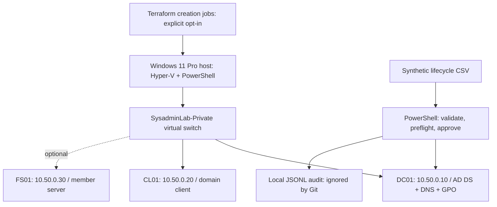

# Architecture

The lab models a small company with IT, HR and Finance departments. Start with one domain controller and one Windows client. FS01 is an optional member-server extension for file services and backup practice; file shares are not automatically configured.



| Component | Suggested resources | Role |
| --- | --- | --- |
| Host | 16 GiB RAM minimum, 24+ preferred; 160+ GiB free SSD | Windows Pro/Enterprise with hardware virtualization, Hyper-V |
| LAB-DC01 / guest DC01 | 2 vCPU, 4 GiB RAM, 64 GiB dynamic disk | Windows Server 2022/2025 Desktop Experience; AD DS and DNS |
| LAB-CL01 / guest CL01 | 2 vCPU, 4 GiB RAM, 80 GiB dynamic disk | Windows 11 Pro/Enterprise; domain client; vTPM and Secure Boot |
| LAB-FS01 / guest FS01 | 2 vCPU, 2–4 GiB RAM, 64 GiB disk | Optional Windows Server member |

RAM suggestions are a starting point, not a detected host capacity. Dynamic disks can grow to their configured maximum; allow space for updates, backups and checkpoints. Windows installers and licenses/evaluation terms are supplied by the operator.

The private switch has no physical uplink and no host NIC. All guests share `10.50.0.0/24`, use static addresses and have **no default gateway**. DNS on clients points only to `10.50.0.10`. There is no DHCP or internet by default. Perform initial configuration in VMConnect; move a sanitized copy of the repository into guests using a read-only ISO, PowerShell Direct, or Hyper-V Guest Service Interface. Do not connect a lab domain controller to a production network.

The reserved `.test` domain is `corp.example.test`, NetBIOS `CORP`. Its directory boundary is:

```text
DC=corp,DC=example,DC=test
└── OU=Lab
    ├── OU=Users           managed employee accounts
    ├── OU=Disabled        retained offboarded accounts
    ├── OU=Groups          LAB-Employees, LAB-IT, LAB-HR, LAB-Finance
    └── OU=Workstations    CL01; linked LAB-Workstation-Lock GPO
```

OU objects are protected from accidental deletion. Approved groups are flat global security groups and must not be nested into any other group. Domain controllers remain in the standard Domain Controllers OU. The sample computer GPO locks inactive sessions after 900 seconds and applies only to the Workstations OU. It is a demonstration setting, not a complete enterprise security baseline.

The automation uses a configured DC for all directory operations, checks domain identity and employee ownership, and preflights the batch before writing. New-user reruns update profile fields and add missing approved memberships without resetting passwords or enabling users. Memberships are additive during onboarding; changing departments requires an operator to review and remove obsolete groups separately. Offboarded accounts cannot be automatically rehired.
